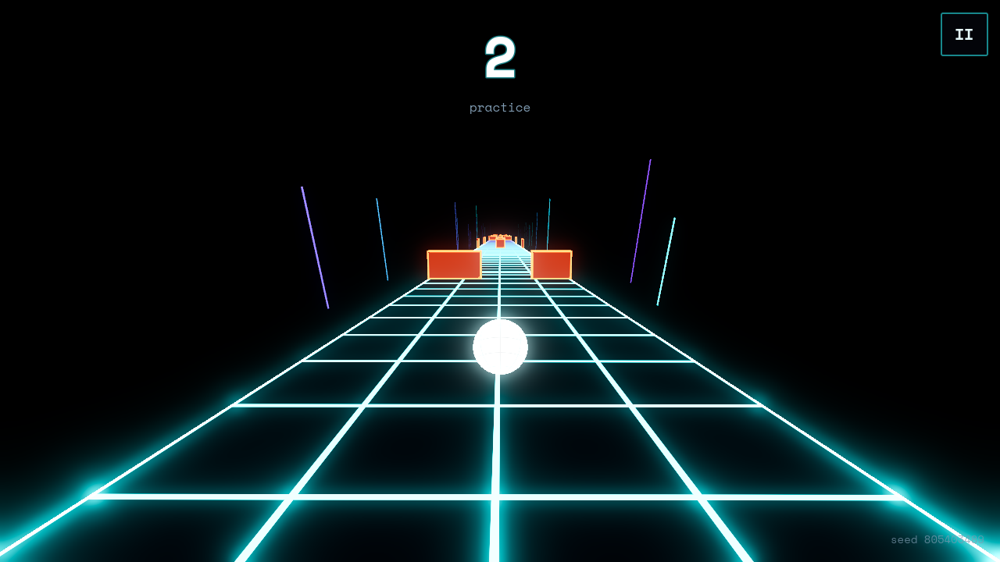
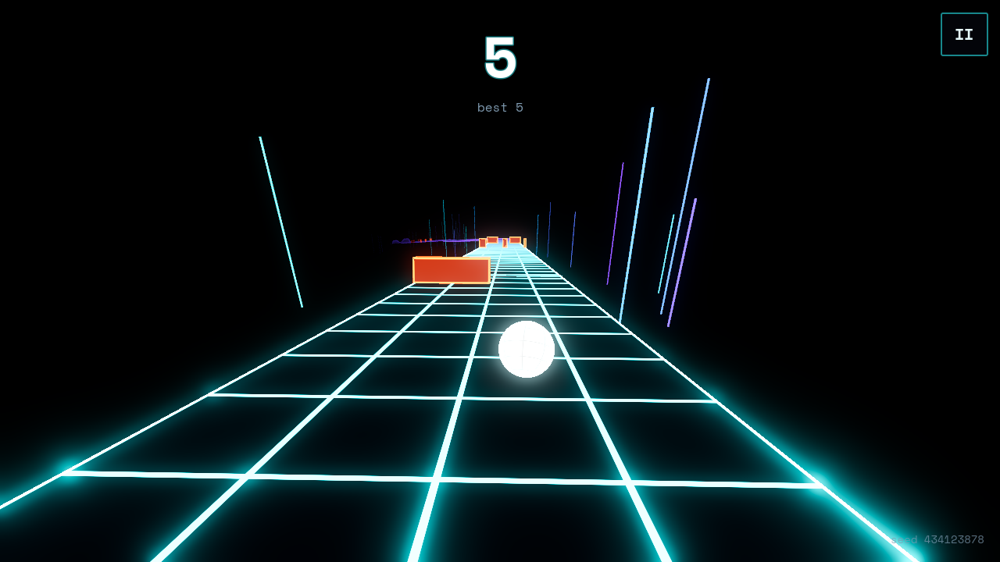
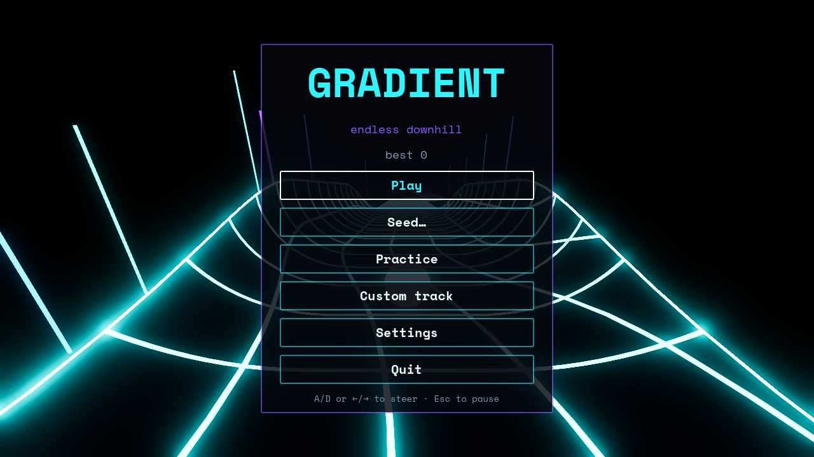
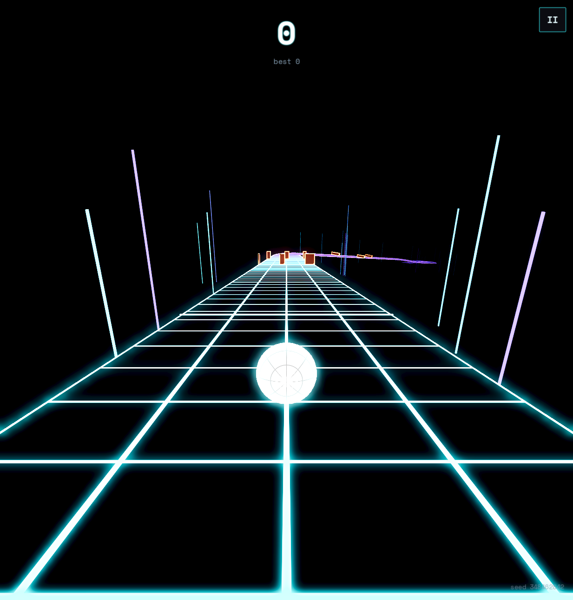

# GRADIENT

An original endless downhill ball-runner for **Godot 4.7** (GDScript, Jolt physics), built
cleanroom from a written spec. Steer a glowing ball down an infinite procedural track.
It only gets faster, and one touch of an orange hazard ends the run.



| | |
|---|---|
|  |  |

## Play

Everything runs through Nix and needs no installs:

```sh
nix run github:first-uninteresting-username/gradient          # play from source
nix run github:first-uninteresting-username/gradient#test     # full acceptance suite (headless)
nix run github:first-uninteresting-username/gradient#export   # Linux / Windows / Web builds into ./build
nix run github:first-uninteresting-username/gradient#editor   # open in the Godot editor
```

From a checkout, use `nix run .#play` and so on. `nix develop` gives a shell with `godot`.

Launch options (after `--`): `--seed=TEXT`, `--practice=chunk:<id>|tag:<tag> --speed=M/S`,
`--autoplay` (a hazard-dodging bot plays), `--bench=SECONDS --screenshot=PATH`.

### Controls

| Action | Keyboard | Gamepad | Touch |
|---|---|---|---|
| Steer | A/D, ←/→ | left stick (deadzone 0.15), D-pad | hold the left/right half of the screen |
| Pause | Esc / P | Start | `II` button |
| Play again / same seed | R or Space / S (death screen) | A / Y | tap |

Keys ramp from 0 to full in 60 ms, and sticks map directly. Keys can be rebound in Settings.

### Modes

* **Endless**: random seed. Only endless runs count toward the main personal best.
* **Seed…**: type a number (used directly) or any text (hashed with FNV-1a 64). The seed is
  shown on the death screen with a copy button. "Same seed" replays it.
* **Practice**: loop one chunk (or every chunk with a tag) at a fixed speed. Death restarts instantly.
* **Custom track**: load or paste a `*.gradient.json` file:

```json
{ "version": 1, "name": "My line", "start_speed": 30,
  "seed": 1234, "loop": false,
  "chunks": ["straight_wide", "ramp_gap", "tube", "picket"] }
```

Profile adapters are inserted automatically between chunks whose profiles don't match.
Reaching the end of a non-looping track completes it.

## How it works

```
autoload/  Game (state machine, modes, seeds), Save (user://save.cfg), Look (palette,
           materials, glow/fog), Audio (procedurally synthesised music + sfx), controls
ball/      Ball.tscn, ball.gd (steering, forward governor, anti-bounce), BallTuning.tres,
           shatter.gd, autopilot.gd (test bot + demo bot)
camera/    ChaseCam: path-tangent chase cam, critically damped lateral spring, FOV/roll
track/     chunk_info.gd (Resource), chunk.gd, chunks/*.tscn (27), track_geometry.gd,
           track_plan.gd (pure generation), generator.gd (streaming, origin shift),
           chunk_validator.gd, hazards/ (block, slider, riser, score gate)
shaders/   grid.gdshader (UV grid + edge rails), hazard.gdshader, ball.gdshader
ui/        title, seed entry, practice, custom track, settings, HUD, pause, death
tests/     headless test runner + acceptance tests
tools/     make_chunks.py (authoring table for the chunk scenes), chunk validation
addons/    gradient_tools: editor plugin that validates chunk profiles on import
```

* **Track**: each chunk scene carries a `ChunkInfo` with authored sections (length, yaw,
  pitch, bank, cross-section profile, gaps, holes, launch ramps) and hazard slots. Geometry,
  `Entry`/`Exit` markers, the centreline `Path3D`, one merged `ConcavePolygonShape3D`, hazards
  and score gates are built from it. Profiles (`flat_wide`, `flat_narrow`, `halfpipe`, `tube`)
  share a point count, so joins use identical vertices and adapters can morph between profiles.
* **Determinism**: `TrackPlan.generate(seed, index)` is a pure function. One
  `RandomNumberGenerator` drives chunk picks, hazard layouts and decor colours. Moving hazards
  run on physics-tick time from an activation point tied to ball progress.
* **Selection**: profile match, `difficulty <= d + 1`, speed band, no repeat of the previous
  two, weight × bell(σ = 2), and a forced breather every 6–9 chunks (from the RNG).
* **Streaming**: 6 chunks ahead and 2 behind. The world origin shifts when the ball passes 2 km.

## Validation

`nix run .#test` runs every check headless. With `--fixed-fps 120`, each frame is exactly
one 120 Hz physics tick, so 40 minutes of game time simulate in about 2.5 minutes.
Last full run: **15,841 checks, 0 failures, 0 engine errors, 0 warnings**.

| Spec acceptance test | Result |
|---|---|
| Same seed → identical first 500 `ChunkSpec`s | ✅ 3 seeds (numeric, text, negative), plus the pure `generate()` |
| 10 min autoplay on flat chunks: 0 airborne frames, 0 seam deaths | ✅ 65.7 km, up to the 120 m/s ceiling, 32 origin shifts, max 1.7 cm above the floor |
| 30 min autoplay, centre-seeking bot, hazards at 60 m/s: no tunnelling | ✅ 1,020 hazard deaths, 0 swept-volume tunnelling events |
| Death → rolling again < 1 s | ✅ 0.4 s death sequence + 1–20 ms track rebuild |
| 120 FPS desktop / 60 FPS Web | ✅ ~2,000 FPS uncapped on an RX 7800 XT (Forward+); Web export holds 60 FPS (vsync) in Chromium |
| Entry/exit profiles validated at import | ✅ editor plugin on `filesystem_changed` + Tools menu + `tools/validate_chunks.gd` + tests |

Extra tests cover FNV-1a 64 test vectors, seed parsing, the speed and difficulty curves,
selection rules over 2,500 picks, the difficulty ramp, a passable gap in every obstacle row
(3,487 rows), join vertices (exact to float precision), custom/practice plans, moving-hazard
replay, steering response at 14 and 50 m/s, every hazard-free chunk being survivable at low,
mid and top speed, the demo bot, and the full UI flow (menu → run → pause → death → same
seed → practice → custom finish).

The exported Linux and Web builds were also run and played (autoplay + screenshots).



## Decisions and deviations from the spec

The spec calls its numbers "tuning starting points". These are the places where this
implementation tuned or departed from them, and why:

1. **Hard speed ceiling of 120 m/s.** Above the 60 m/s soft cap, speed still grows at a quarter
   rate. That growth is exponential in time (about 390 m/s after 10 minutes, and Jolt clamps
   at 500). Above about 150 m/s (more than 1.25 m per 120 Hz tick), Jolt's speculative contacts
   catch chunk-join edges and kick the ball. 120 m/s (432 km/h) is far beyond reaction
   limits and is verified seam-free.
2. **Anti-bounce is stricter than 1.5 m/s.** The spec says real launches only come from ramp
   volumes. So while the floor is within snap reach and no launch is armed, *all* upward
   velocity off the floor is removed (`BallTuning.strict_snap`), not only kicks below 1.5 m/s.
   Edge kicks measured 4–14 m/s at 100–155 m/s. A small **join guard** also shortens the one
   step that would start within 0.2 m before a chunk join (the speculative-contact zone),
   above 30 m/s.
3. **One floor body for all chunks.** Each chunk still builds its own merged
   `ConcavePolygonShape3D`, but every chunk's shape is attached to a single streamed
   `StaticBody3D`. Jolt removes ghost contacts on internal edges only within one body, and
   with one body per chunk every join produced a ~3 m/s kick even at 16 m/s.
4. **Hazards appear from the start and ramp up.** Hazard chunks are rated from difficulty 1
   (scattered blocks) upward. Row spacing, blocks per row, picket opening width and
   slider/riser tempo scale with difficulty. Every row keeps a passable gap. Five extra
   hazard chunks (slalom, narrow blocks, blocks in a turn, halfpipe blocks, gauntlet) bring
   the catalogue to 21 gameplay chunks plus 6 profile adapters.
5. **Hazards ignore the fog.** They fade in on their own from 320 m, while the track still
   rises out of the darkness. They are the gameplay readout.
6. **Kill plane.** "Below the chunk's `kill_plane_y` minus 8 m" uses the lowest floor point
   at the ball's position along the chunk, rather than the whole chunk's minimum. The spec's
   version would let a ball fall about 25 m on a long descending chunk before dying.
7. **Tests use a small in-repo runner** instead of GUT or gdUnit4. It runs headless under Nix
   with no third-party addon, and it fails on any engine or script error (via `Logger`).
8. **Chunk scenes are authored as data.** The 27 `.tscn` files are generated from one table
   (`tools/make_chunks.py`) and stay editable in Godot. Geometry is built procedurally from
   their sections.
9. **Audio is synthesised at start-up** (synthwave loop with a speed-driven low-pass, whoosh,
   chime, glass shatter), so it is original and CC0 by construction.
10. **Open questions:** the name and palette placeholders are kept. Replays are left out of v1.
    Basic touch steering is included.

## Credits and licence

Code and original assets: **GNU Affero General Public License v3.0** (see `LICENSE`).
The font, Space Mono, keeps its own SIL Open Font License 1.1 (`assets/fonts/OFL.txt`).
